<h1 align="center">Hi, I'm Tanmay Singh 👋</h1>

  <strong>Software Engineer | Specialized in Scalable Distributed Systems & Full-Stack Development</strong>

  

---

### 🧠 Profile Overview

* 🚀 **System Design:** Building **Modular Monoliths** and **Microservices** with a focus on domain-driven design.
* ☕ **Modern Java:** Leveraging **Java 25 Virtual Threads** and **Spring Boot 4** for high-throughput backends.
* ⚙️ **API Development:** Designing robust RESTful APIs and asynchronous event-driven architectures.
* 🅰️ **Frontend Engineering:** Crafting reactive UIs using **Angular**, **Signals**, **RxJS**, **SingleSPA**, and **Webpack**.
* ☁️ **Cloud Infrastructure:** Architecting scalable environments on **AWS** including EC2, S3, RDS, CloudWatch, and EKS.
* 📦 **Open Source:** Maintaining [npm packages](https://www.npmjs.com/~tanmaysinghx99) for the developer community.

---

### 🏛️ Architectural Expertise

* **Modular Monoliths:** Designing encapsulated modules to ensure easy transitions to Microservices when needed.
* **Microservices:** Orchestrating services with **Spring Cloud**, **Kafka** for events, and **Redis** for state.
* **Event-Driven Architecture:** Implementing asynchronous communication, background processing, and robust messaging pipelines.
* **DevOps:** Automating deployments via **Jenkins**, **Docker**, and **GitHub Actions**.

---

### 🛠️ Tech Stack & Infrastructure

| Layer              | Technologies                                                                                  |
| :----------------- | :-------------------------------------------------------------------------------------------- |
| **Core Backend**   | **Java 25**, **Spring Boot 4.x**, Hibernate, Spring Security, JDBC, Lombok, Spring Validation |
| **Core Frontend**  | **Angular**, TypeScript, RxJS, SCSS, Tailwind                                                 |
| **Cloud (AWS)**    | **EC2**, **S3**, **RDS**, **EKS**, Lambda, IAM                                                |
| **Messaging/Data** | **Apache Kafka**, **Redis**, MySQL, PostgreSQL, FFmpeg                                        |

---

### 🌍 Open Source Contributions

Recent work I've contributed to projects outside my own repos:

#### 🦀 [AlienTechSoftware/notecraft](https://github.com/AlienTechSoftware/notecraft) — open-source note-taking app in pure Rust
* 🟡 [feat(boxes): remove a blank box once the caret leaves it](https://github.com/AlienTechSoftware/notecraft/pull/48) — *open, Nov 2026*
* ✅ [fix: stop a click beside an object from deadlocking the window](https://github.com/AlienTechSoftware/notecraft/pull/16) — *merged, Oct 2026*
* ✅ [fix(rtl): lay a line out in the page's direction, not its first letter](https://github.com/AlienTechSoftware/notecraft/pull/13) — *merged, Oct 2026*

#### 🔐 [GetAppCraft-Inc/portal-sso](https://github.com/GetAppCraft-Inc/portal-sso) — Java SSO / OIDC identity portal
* ✅ [feat: add login URL to applications for OIDC third-party initiated login](https://github.com/GetAppCraft-Inc/portal-sso/pull/15) — *merged, Nov 2026*
* ✅ [feat: implement setup wizard for initial configuration](https://github.com/GetAppCraft-Inc/portal-sso/pull/14) — *merged, Nov 2026*
* ✅ [fix: secure and smooth first-run setup; add browser E2E gate to CI](https://github.com/GetAppCraft-Inc/portal-sso/pull/1) — *merged, Oct 2026*
* ✅ [chore: add Dependabot for dependency and security updates](https://github.com/GetAppCraft-Inc/portal-sso/pull/2) — *merged, Oct 2026*
* ✅ [Bug fixes](https://github.com/GetAppCraft-Inc/portal-sso/pull/13) — *merged, Oct 2026*

#### 🎫 [Peppermint-Lab/peppermint](https://github.com/Peppermint-Lab/peppermint) — open-source help desk & issue tracker (⭐ 3k+)
* ✅ [Modified random digit generator](https://github.com/Peppermint-Lab/peppermint/pull/370) — *merged, Sep 2024*

👉 [See all my pull requests](https://github.com/pulls?q=is%3Apr+author%3Atanmaysinghx+-user%3Atanmaysinghx)

---

### 🏆 Certifications

| Certification                                                                                                                                                                            | Issuer    | Credential ID                      | Expiry    |
| :--------------------------------------------------------------------------------------------------------------------------------------------------------------------------------------- | :-------- | :--------------------------------- | :-------- |
|                                             | Microsoft | `B94AF1A881AD1347`                 | Jun 2028  |
|  | Microsoft | `94C369F93FF70A31`                 | No Expiry |
|       | AWS       | `e6e9e3a34d224dc29a36ccdf1336cb32` | Aug 2028  |
|       | AWS       | `553056fb23f04e4abe367a7a1dbd1684` | Jul 2028  |
|         | AWS       | `2126d0468c3646a590f09012a4ec8c95` | Jun 2028  |

---

### 📊 GitHub Stats & Impact

  
  

> **Note:** `stats.svg` and `top-langs.svg` need to exist in your profile repository. These are separate from the DSA section.

---

### 🧠 DSA Journey

> Tracking my journey through Data Structures & Algorithms by solving
> LeetCode problems and documenting every solution.

<table>
  <tr>
    <td align="center">
      <strong>🔥 Problems Solved</strong> 
      <h2>45+</h2>
    </td>
    <td align="center">
      <strong>🟢 Easy</strong> 
      <h2>41</h2>
    </td>
    <td align="center">
      <strong>🟡 Medium</strong> 
      <h2>3</h2>
    </td>
    <td align="center">
      <strong>🔴 Hard</strong> 
      <h2>1</h2>
    </td>
  </tr>
</table>

---

### 🤝 Connect & Collaborate

  
  
  

---

### 📈 Profile Views

*Counting of visitors to this page started from June 12, 2022.*

  

---
